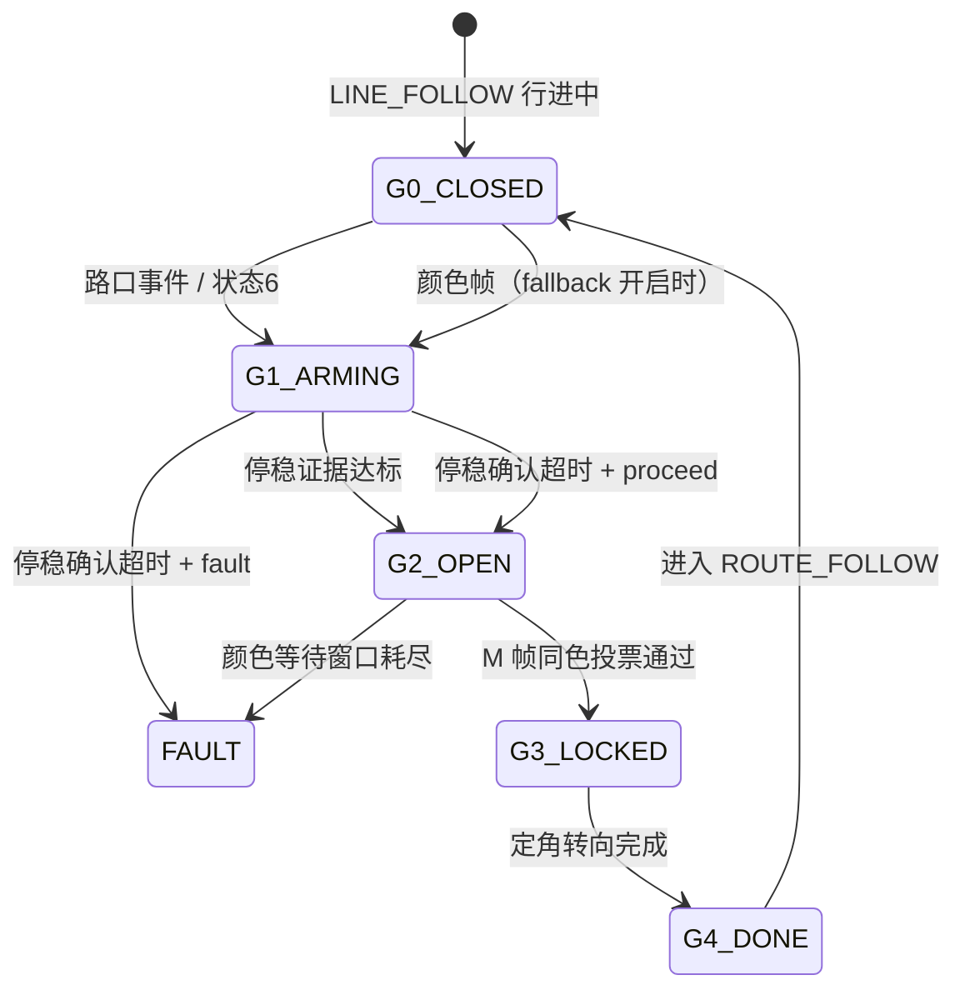

# VOYAGER_NEW · 路口「停车 → 色卡识别」闸门（方案 A）

> 在**电机循迹完成（到达三岔路口）之后、色卡识别结果被采信之前**，由导航端先向电控端
> 下发停车、取得停稳证据，再打开一个受限的识别窗口，投票锁定颜色后才允许转向。
>
> 约束：**不修改 `robopioneers_navigation` 任何文件、不修改任何通信参数、不新增电控命令字。**
>
> 本目录含一个**可直接 `colcon build`** 的 ROS 2 功能包 `voyager_gate/`。

---

## 一句话结论

现有代码里「停车」这一半已经有了，「停稳后才采信颜色」这一半没有：

| 环节 | 现状（改造前） | 位置 |
|---|---|---|
| 电机循迹完成 → 上报路口 | 固件 `0x11` event bit0 / `0x10` state=6 | [navigation_node.py:714](../robopioneers_navigation/robopioneers_navigation/navigation_node.py#L714) |
| 导航 → 电控 停车帧 | `CMD_CHASSIS(0,0)` + 20 Hz 零速保持 | [navigation_node.py:1185](../robopioneers_navigation/robopioneers_navigation/navigation_node.py#L1185) |
| 停稳证据 | 只在 `WAIT_MOTOR_STOP`（STOP 牌）用，路口不用 | [navigation_node.py:688](../robopioneers_navigation/robopioneers_navigation/navigation_node.py#L688) |
| 色卡识别 | 行进中就被锁进 `selected_route` | [route_controller.py:253](../robopioneers_competition/robopioneers_competition/route_controller.py#L253) |
| 转向 | `selected_route` 非空就立刻转 | [route_controller.py:329](../robopioneers_competition/robopioneers_competition/route_controller.py#L329) |

本方案补的正是后三行。

---

## 时序（改造后）

```
电机固件：全黑路口 → 本地刹停 → 0x10 state=6 / 0x11 event bit0
        │
        ▼
导航：JUNCTION_DETECTED → WAIT_ROUTE_MANEUVER
        │  ① 下发 CMD_CHASSIS(0,0)          ← 你要的"一条通信"
        │  ② 20 Hz 零速保持（喂 300 ms 看门狗）
        ▼
   闸门 G1 ARMING：等 0x10 实测左右轮速归零 ×N 帧 + 驻留 dwell
        │  ③ JUNCTION_STOP_CONFIRMED
        ▼
   闸门 G2 OPEN：COLOR_WINDOW_OPEN          ← 语义上的"调用色卡识别模块"
        │  ④ 窗口内连续 M 帧同色 → 投票锁定
        ▼
   闸门 G3 LOCKED：ROUTE_COLOR_READY
        │  ⑤ 定角转向（heading_deg 开环）
        ▼
   闸门 G4 DONE：ROUTE_TURN_REACHED → ROUTE_FOLLOW
```



关键性质：**G0 / G1 阶段收到的颜色帧一律丢弃，既不记录也不投票。**

---

## 快速开始

```bash
# 1) 与原件放进同一工作空间（原件不改动）
cp -r robopioneers_navigation  ~/ws/src/
cp -r VOYAGER_NEW/voyager_gate ~/ws/src/

# 2) 离线算法自检（不需要 ROS / 硬件）
python3 VOYAGER_NEW/03_参考实现.py
#   期望：13/13 checks passed / ALL SCENARIOS PASSED

# 3) 构建并运行
cd ~/ws
colcon build --packages-select robopioneers_navigation voyager_gate
source install/setup.bash
ros2 launch voyager_gate voyager_gate.launch.py
```

```bash
# 观察相位（应依次出现）
ros2 topic echo /navigation/competition/status
# JUNCTION_PARKED → JUNCTION_STOP_CONFIRMED → COLOR_WINDOW_OPEN
#   → ROUTE_COLOR_READY → ROUTE_TURN_BEGIN → ROUTE_TURN_REACHED → ROUTE_FOLLOW

# 识别窗口开关信号
ros2 topic echo /navigation/junction/color_request
```

详细步骤见 [`voyager_gate/README.md`](voyager_gate/README.md)。

---

## 三个判据（摘要）

**① 停稳证据**（一帧算「停」当且仅当）

```
fresh(Δt ≤ 0.25 s) ∧ state ∈ {0 IDLE, 6 JUNCTION} ∧ |v_L| ≤ thr ∧ |v_R| ≤ thr
```

连续 N 帧满足 **且** 从首帧起已过 `dwell` 秒 → 确认停稳。

**② 识别窗口** —— 不是时间区间，而是状态谓词：

```
window_open ⟺ state == WAIT_ROUTE_MANEUVER ∧ stop_confirmed
```

等价于 `[t_confirm, t_confirm + route_junction_color_wait_s]`，但不需要额外定时器。

**③ 颜色锁定**

```
vote(c_k) ↑  若 c_k == c_{k-1} 且 (t_k − t_{k−1}) ≤ vote_timeout
lock         若 vote ≥ M
else reset   颜色变化 或 超时
```

---

## 目录

```
VOYAGER_NEW/
├── README.md                 # 本文件：结论 + 快速开始
├── 01_算法设计.md            # 不变量、闸门相位、三个判据、时序预算、降级矩阵、参数
├── 02_改动清单.md            # 手工合并回 robopioneers_competition 时用的逐函数清单
├── 03_参考实现.py            # 可执行入口（转调包内离线自检）
├── 04_验证与标定.md          # 台架复现、上车步骤、日志判读、参数标定、故障演练
├── 05_风险与回退.md          # 风险矩阵、方案 B 对比、三级回退
└── voyager_gate/             # ★ 可直接 colcon build 的 ROS 2 功能包
    ├── package.xml / setup.py / setup.cfg / resource/
    ├── README.md             # 包说明：构建、运行、参数、观测
    ├── config/voyager_gate.yaml
    ├── launch/voyager_gate.launch.py
    ├── tools/gate_selftest.py
    └── voyager_gate/
        ├── junction_gate.py      # 闸门判据实现
        ├── competition_base.py   # 模板副本：定角转向 + STOP 定距
        └── voyager_node.py       # 接线后的可执行节点（唯一入口）
```

---

## 兼容性与回退

- 新增 9 个参数，全部带默认值，YAML 不写也能跑。
- 新增 1 个话题 `/navigation/junction/color_request`（`std_msgs/Bool`），原有话题一个不动。
- `junction_gate_enabled: false` → 关闸门（保留投票）；
  再加 `route_color_vote_frames: 1` → **与改造前逐字段一致**。
- 不改 `robopioneers_navigation/` 一个字节；不改端口 `5000/5001/5002`、
  串口 `ttyUSB0·1·2`、波特率 `115200`、两套帧格式。
